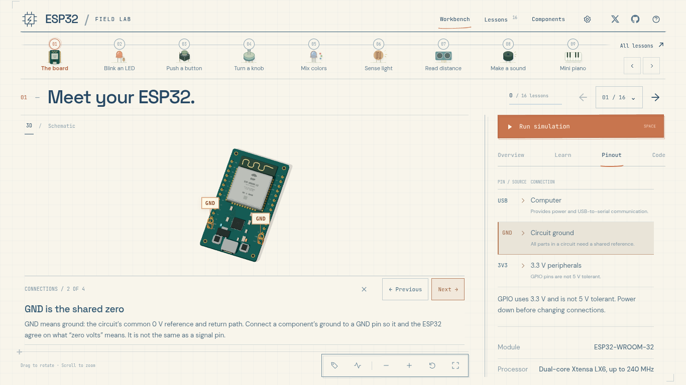
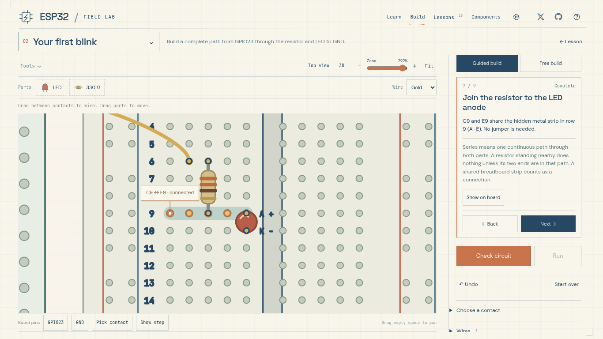

# ESP32 Field Lab（简体中文版）

一个基于浏览器的交互式课堂，面向搭载 ESP32-WROOM-32 的原版 30 引脚 ESP32 DevKit V1。你可以在桌面电脑或手机上探索 3D 开发板、操作元件，并学习 16 节课程。

> 本项目是 [ardchain/esp32-field-lab](https://github.com/ardchain/esp32-field-lab) 的简体中文版本，原项目及其许可证声明予以保留。

**[打开实验室](https://hinkerliu.github.io/esp32-field-lab/)**



- 程序化生成的 3D 开发板与元件模型，支持悬停和点击查看。
- 直接交互：按住按键、旋转旋钮、遮挡光线传感器、弹奏钢琴键或转动舵机。
- 68 个可视化连接步骤：镜头会对准每个部件，并高亮精确的引脚与电阻值。每一行 Pinout 都会打开对应的说明。
- 电路原理图、面包板入门、Arduino 示例、实验与知识测验。
- Blink、Button 和 Potentiometer 的装配练习：放置元件、连接真实面包板导电条、检查电路并在 3D 中操作。
- 课程进度和装配草稿保存在当前浏览器中，无需账户或后端。
- 桌面工作台适配窗口大小，课程面板内可滚动；手机上支持触摸操作与页面滚动。
- 支持键盘导航与减少动态效果。

## 课程

开发板基础 · LED 闪烁 · 按键 · 电位器 · RGB LED · 光线传感器 · 超声波测距 · 压电发声 · 迷你钢琴 · 直流电机 · 温度 · 舵机 · 步进电机 · 植物监测 · 力传感器 · Wi-Fi

## 本地运行

本站由纯 HTML、CSS 和 JavaScript 构成。Three.js 与字体均在本地打包，无需构建步骤。

```sh
git clone https://github.com/Hinkerliu/esp32-field-lab.git
cd esp32-field-lab
python3 -m http.server 4173 -d dist
```

打开 <http://localhost:4173>。请通过 HTTP 提供文件，而不是直接打开 `index.html`，因为应用使用了 JavaScript 模块。

## 课程操作

拖动空白处可水平旋转，滚动或双指捏合可缩放。悬停或点击无源元件即可查看，也可以使用元件库。根据场景上方的提示操作可交互元件，演示会自动开始。按住 Shift/Alt 点击可交互元件可对其进行查看。

选择 **Show the connections（显示连接）**，或选中某一行 **Pinout（引脚）**，即可进入引导式特写。运行模拟或手动控制镜头会返回自由探索模式。标签默认关闭。

- **空格键：**运行或停止演示。
- **R：**重置镜头。
- **[ / ]：**上一节或下一节课程。
- **Escape：**关闭面板。

## 搭建电路

在导航中打开 **Build（搭建）**，按课程编号和标题选择项目。**Guided build（引导式搭建）** 会先展示面包板内部隐藏的连接：五孔导电条、中间凹槽和电源轨。随后每一步都会高亮某个元件或连接并说明其作用。点击建议元件的虚影即可放置其完整封装，或点击 **Do this step（执行此步骤）**。**Next（下一步）** 会进入后续说明。引导会跟随你的实际布局，包括有效的替代接法，并会保留已保存的电路。

使用 **Free build（自由搭建）** 可以直接探索。从元件托盘放置元件，然后从一个空闲触点拖动到另一个触点即可添加导线。也可以先点击起始触点，移动悬空的线头，再点击目标触点。右键或按 Escape 取消；屏幕上可见的 Cancel 按钮同样适用于触摸屏。将新导线拖到触点以外的地方会取消该草稿。拖动已放置的元件可移动它；即使选中了元件，点击插孔也会开始布线。选中导线后拖动任一端点即可重新连接，另一端保持不动。无效的放置会保留原导线。点击元件或导线可选中它；再次点击已选中的主体可将其移除，然后用 **Undo（撤销）** 恢复。紧凑的 **Tools（工具）** 菜单保留明确的 Select / Move（选择/移动）、Wire（布线）和 Delete（删除）模式；键盘 Delete/Backspace 也可删除所选内容。滚动、双指捏合或使用 **Zoom（缩放）** 滑块可改变视图。触点选择器可作为指向小插孔的替代方式。

| 项目 | 电路与行为 |
| --- | --- |
| [Blink](https://hinkerliu.github.io/esp32-field-lab/#build-blink) | GPIO23 通过电阻驱动 LED；可改变其闪烁间隔。 |
| [Button](https://hinkerliu.github.io/esp32-field-lab/#build-button) | 将四脚开关连接到 GPIO18 和 GND；按下时读数为 LOW 并点亮 LED。 |
| [Potentiometer](https://hinkerliu.github.io/esp32-field-lab/#build-potentiometer) | 用 3.3 V 为 10 kΩ 电位器供电；其滑动端接入 GPIO34 并控制 LED 亮度。 |



**Check（检查）** 会评估连通性、LED 极性、限流、占用的插孔以及电源短路。有效的接法可以使用不同的行、导线颜色、电源轨，或将电阻接在 LED 的任意一侧。面包板的每一行中 a–e 与 f–j 彼此分开导通；四条电源轨各自连续且相互独立。每个触点只能容纳一根引脚或跳线。ESP32 的两个接地引脚属于同一网络，但物理上是独立的触点。

布线时，被占用的端子会解析为同一导通连接上的空闲触点；在连接前，预览会显示实际的端点。被占用的 GND 排针会优先选用另一个空闲的 GND 排针，使共地更容易理清。此规则只依据面包板导电条和现有导线，绝不会穿过电阻或 LED。已经连接的端点不会添加重复的导线。

检查通过后即可运行。编辑或恢复草稿会停止播放，并需要重新检查。提示会在实际位置显示建议的元件或导线，并在目标旁附上简短说明。如果导线绕过电阻直接接到 LED，修复指南会指出需要移动的线端和剩余的连接。每次修复都需要明确的操作，并且可以撤销。撤销会保留上一次编辑，包括重置操作。每个项目都有各自保存的草稿；装配完成与课程测验相互独立。

这些是针对所提供的三个项目的连通性检查器，并非通用的电路求解器或 C++ 编译器。每个通过检查的电路都会驱动对应的演示。按键会模拟其两对永久连通的引脚以及按下状态。电位器会模拟不同的电阻轨端和滑动端，包括外侧连接反接的情况。课程场景保留其示意导线；Build 模式则将导线连接到所选触点。

## 项目结构

| 路径 | 用途 |
| --- | --- |
| `dist/index.html` | 应用外壳 |
| `dist/app.js` | 导航、课程面板、控件、测验与进度 |
| `dist/scene.js` | 程序化 3D 模型、镜头、高亮、装配渲染与交互 |
| `dist/build.js`, `dist/build.css` | 装配编辑器、提示、验证反馈与草稿持久化 |
| `dist/build-circuit.js` | 面包板网络、元件封装、占用情况与项目电路规则 |
| `dist/build-projects.js` | 装配项目目录、课程名称、示例摆放、控件与示意图 |
| `dist/build-project-picker.js`, `dist/build-project-picker.css` | 支持指针、触摸和键盘导航的精美课程选择器 |
| `dist/build-walkthroughs.js` | 跟随学习者实际布局的引导式装配说明与连接步骤 |
| `dist/lessons.js` | 课程内容、Arduino 示例草图与元件参考 |
| `dist/guides.js` | 分步骤的可视化连接导览 |
| `dist/diagrams.js` | 电路图与面包板连通性 |
| `dist/style.css`, `dist/guide.css` | 响应式布局与样式 |
| `tests/` | 电路规则测试与浏览器回归检查 |

## 检查

开发检查需要 Node.js 20 或更高版本。Python 3 仅用于上面的本地服务器。

```sh
npm ci
npm run check
npx playwright install --with-deps chromium
npm test
```

检查覆盖全部课程、设备直接交互、可视化导览目标、导航、镜头边界、测验、已保存进度和窄屏布局。装配检查包括面包板连通性、替代有效电路、常见接线错误、真实的指针/键盘/触摸装配、滚轮缩放、拖动、删除、可视化提示、3D 播放、撤销、已保存草稿和下载的代码。

运行 `npm run test:circuit` 可仅检查电路规则，运行 `npm run test:build` 则同时检查电路规则和装配浏览器测试。浏览器测试会向测试响应中注入观察辅助函数；生产环境中没有测试全局变量。它们会在端口 4181、4184、4185 和 4194 上启动本地服务器。截图和报告会写入临时目录，或由 `QA_OUTPUT` 指定的目录。

要使用已安装的 Chromium，请在运行测试前将 `CHROMIUM_EXECUTABLE` 设为它的可执行文件路径。

## 部署

随附的 GitHub Actions 工作流会在 `main` 分支发生变化时将 `dist/` 发布到 GitHub Pages。在仓库的 **Settings → Pages（设置 → 页面）** 中，选择 **GitHub Actions** 作为来源。资源使用相对路径，因此站点在项目 URL（如 `/esp32-field-lab/`）下也能正常工作。

你可以用任何静态托管服务来提供 `dist/`，包括 Vercel、Netlify 或常规 Web 服务器。

## 模拟与硬件

浏览器运行交互式的课程演示，不会编译 C++、模拟 ESP32 CPU 或连接实体开发板。输出监视器显示演示状态。六个输出控件会更新可下载示例中的常量；传感器控件会改变模拟条件。

Arduino 示例面向 Arduino-ESP32 3.x 和原版 ESP32-WROOM-32。依赖库的草图和实体接线应在目标开发板上验证；其他 ESP32 型号的引脚和功能有所不同。GPIO 使用 3.3 V，不兼容 5 V。3D 场景用于示意搭建方式；接线表和电路图描述的是预期的连接。

进度和偏好设置使用 localStorage 保存，仅保留在同一浏览器和站点来源中，不会在设备或域名之间同步。

### 3D 模型参考

模型展示的是选定的元件封装和常见开发板变体。端子数量、引脚名称和机械方向与以下参考资料一致；尺寸和细节为便于阅读做了调整。这些是风格化的教学插图，不是带尺寸的 CAD 或装配图。钢琴键帽代表八个输入开关。课程中面包板导线的端点仅为示意；Build 模式使用所选触点的坐标。

| 模型 | 硬件参考资料 |
| --- | --- |
| 30 引脚 ESP32 DevKit V1 | [DOIT 文档](https://github.com/SmartArduino/SZDOITWiKi/wiki/ESP8266---ESP32) 和 [厂商原理图](https://github.com/SmartArduino/ESPboard/blob/master/esp32manual.rar) |
| ESP-WROOM-32 模组 | [Espressif 数据手册](https://documentation.espressif.com/esp32-wroom-32_datasheet_en.html)：38 个半孔端子和 PCB 天线 |
| USB 桥接芯片与稳压器 | [CP2102 QFN28](https://www.silabs.com/documents/public/data-sheets/CP2102-9.pdf), [1117 SOT-223 封装](https://www.onsemi.com/pdf/datasheet/ncp1117-d.pdf) |
| 共阴极 RGB LED | [Kingbright 四引脚 LED](https://www.kingbrightusa.com/images/catalog/SPEC/WP154A4SUREQBFZGC.pdf) |
| 超声波模组 | [经典 5 V HC-SR04](https://cdn.sparkfun.com/datasheets/Sensors/Proximity/HCSR04.pdf) |
| 温湿度传感器 | [Aosong DHT22 / AM2302 数据手册](https://www.airsupplylab.com/images/Learn/Embedded/Datasheets/DHT22_Temperature_and_Humidity_Sensor.pdf)：裸四引脚封装 |
| 舵机 | [TowerPro SG90](https://towerpro.com.tw/product/sg90-analog/) |
| 步进电机与驱动器 | [28BYJ-48](https://download.mikroe.com/documents/datasheets/step-motor-5v-28byj48-datasheet.pdf), [ULN2003A DIP-16](https://www.ti.com/lit/ds/symlink/uln2003a.pdf) |
| 直流电机开关电路 | [AO3400A SOT-23](https://www.aosmd.com/res/data_sheets/AO3400A.pdf)（装在通用转接板上）；[轴向二极管与阴极色环](https://www.vishay.com/docs/88503/1n4001.pdf) |
| 模拟输入 | [三端电位器](https://www.bourns.com/docs/product-datasheets/PTV09.pdf), [两端 FSR](https://www.interlinkelectronics.com/downloads/datasheets/fsr-400-series-datasheet.pdf), [电容式土壤探头](https://wiki.dfrobot.com/sen0193/) |
| OLED | 使用 [SSD1306 控制器](https://cdn-shop.adafruit.com/datasheets/SSD1306.pdf) 的通用四引脚 I2C 模组；转接板引脚顺序不一，请以其丝印标签为准 |
| 面包板 | [400 孔半尺寸布局](https://www.adafruit.com/product/64)：300 个端子插孔和 100 个电源轨插孔 |

## 许可证

原始应用代码、课程内容和素材均遵循 [MIT License](LICENSE)（MIT 许可证）。

打包的依赖保留各自的声明：

- [Three.js r170 — MIT](dist/vendor/THREE-LICENSE.txt)
- [DM Sans — SIL Open Font License](dist/fonts/DM-Sans-OFL.txt)
- [JetBrains Mono — SIL Open Font License](dist/fonts/JetBrains-Mono-OFL.txt)
- [Space Grotesk — SIL Open Font License](dist/fonts/Space-Grotesk-OFL.txt)

交互式课程形式受 [Learn Arduino](https://learn-arduino-red.vercel.app/) 启发。本项目使用自己的界面、内容和程序化 3D 模型。
